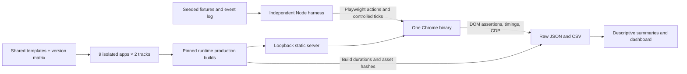
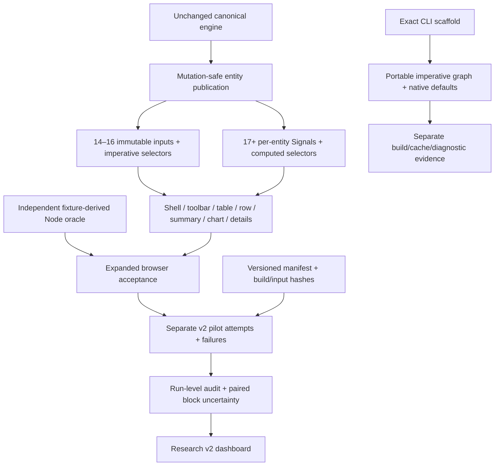

# Architecture

`packages/market-fixtures/engine.js` is a dependency-free UMD engine used unchanged by Node and browser script bundles. Angular compilers do not consume modern shared TypeScript. `packages/benchmark-contract/contract.json` defines the external interface. `templates/` owns the common UI and compatible adapter body; `scripts/generate.mjs` materializes isolated projects and explicit stable architecture variants. Generated source is committed so changes can be reviewed without executing a generator. Edit templates then regenerate; do not hand-edit generated source.

`v14/` … `v22/` each have exact framework/CLI/TypeScript/RxJS/Zone/tslib pins, their own lockfile, `.nvmrc`, and two build targets. Baseline and idiomatic are separately built bundles, not runtime switches. The harness does not load into Angular and controls updates over `window.market`.

The applications previously lived at `apps/angular-14/` … `apps/angular-22/`. Historical commits and benchmark provenance refer to that earlier layout; the recorded raw results and hashes are unchanged. Reproduction with the current checkout uses the corresponding `v<major>/` directory.

`scripts/build.mjs` installs pinned local Node/npm pairs, resolves dependencies on first install then uses npm ci, clears build caches and records production build artifacts. `scripts/serve.mjs` serves only static files bound to loopback. `benchmark/harness/functional.mjs` gates measurements; `run.mjs` executes replay and stores raw JSON; `summarize.mjs` emits descriptive JSON/CSV. `dashboard/` is an independent dependency-free results explorer and never loads into measured apps.

The terminal has no network API dependency. Timers only control delivery cadence; they never choose events. Initial state is paused to protect navigation measurements. UI controls and the harness use the same state transition code. No persistence is used, ensuring watchlist reset is repeatable.

## Research v2 namespaces

The legacy generator and source remain intact. `scripts/generate-research.mjs` emits independent B and portable C source under `v*/src/research`, with separate build recipes and manifests. `native/v*` retains exact CLI default configurations; `research/native/v*/scaffold` preserves the unmodified scaffold and `adaptation.json` records the changes. Default builders are observed from generated recipes, not inferred from installed packages.

Signal row consumers read only their own entity, watch and selection publications. The ordered-ID computed selector reads prices only for price sorting. The selected panel follows only the selected entity; aggregate work remains a full reduction. Older optimized components use immutable touched inputs and explicit invalidation rather than deliberately eager selectors. Both new designs preserve canonical mutation/allocation semantics and include UI publication cost in timings. See [v2 methods](docs/RESEARCH_V2_METHODS.md).
