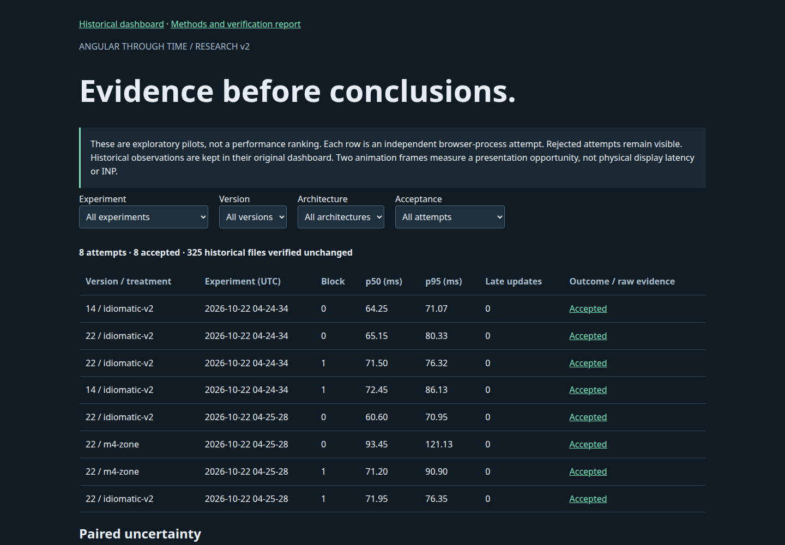

# Angular Through Time

[](https://github.com/Omri93Rajuan/angular-through-time/actions/workflows/ci.yml)

**Angular Through Time** is a reproducible research project comparing the same fictional Market Terminal application across Angular 14–22. It includes isolated Angular applications, a deterministic market-data simulator, browser benchmark tooling, saved raw observations, verification records, and a results dashboard.

The project is an experimental apparatus, not a claim that one Angular release or architecture is universally faster.

## Repository layout

```text
v14/ … v22/                 Version-pinned Angular applications (baseline and idiomatic)
benchmark/                  Browser harness, raw results, audits, and summaries
dashboard/                  Standalone results explorer
docs/                       Version matrix and verification records
packages/                   Deterministic market engine and benchmark contract
scripts/                    Generation, builds, serving, and verification
templates/                  Shared generated application sources
```

Each `v14/` through `v22/` directory contains that Angular version's independent dependencies, lockfile, build configuration, and generated application source. Benchmark and documentation locations remain unchanged.

## Market Terminal

Market Terminal is a client-only monitoring interface for 5,000 fictional assets. Its seeded engine and deterministic event log make the same market updates replayable across versions. The UI includes search and filtering, sorting, watchlist and selected-asset details, summaries, and a price chart. It uses no real market feed, backend, credentials, CDN assets, or trading functionality.

## Research tracks and evidence

The original 18 `baseline` / `idiomatic` variants and all their raw results remain intact. The historical idiomatic variant is a revision-signal adapter, not a fully reactive Signals architecture.

Research v2 adds separately generated component architectures and exact CLI-default workspaces. See the [v2 report](docs/RESEARCH_V2_REPORT.md) for executed verification, failures and outstanding work; [methods](docs/RESEARCH_V2_METHODS.md) and [replication guide](docs/RESEARCH_V2_SETUP.md) define the new protocol.

| Track | Implementation | Evidence boundary |
|---|---|---|
| Legacy controlled / conservative idiomatic | Original eager monoliths, controlled webpack | Original short historical observations only |
| `idiomatic-v2` | OnPush component graph; optimized immutable state on 14–16; actual per-entity signals/computed on 17+; stable flow and zoneless transitions | New correctness checks and separately labeled pilots |
| `default-cli-v1` | CLI-generated native defaults with a portable imperative graph and dedicated locks | Separate build/cache and diagnostic observations |
| Matched `M4` | Angular 22 signal graph with Zone versus zoneless scheduling | Same-version pilot; no cross-version feature attribution |

The [historical dashboard](dashboard/) and [v2 evidence explorer](dashboard/research.html) do not pool results. The main confirmatory campaign has **not been authorized or run**. Small pilots do not support rankings or statistical-significance claims.

To reproduce v2 after installing root dependencies:

```bash
VERSIONS=14,22 node scripts/setup-research.mjs
npm run research:build
npm run research:verify
npm run research:pilot
npm run research:audit
```

Use the [full setup guide](docs/RESEARCH_V2_SETUP.md) for all nine versions, native CLI workspaces, diagnostics and exact prerequisites. The original commands below reproduce the historical apparatus.



## Quick start

Use Node **22.23.2** and a compatible npm version (the project was verified with npm **10.9.8** and **11.6.2**). The first setup/build needs network access to install dependencies and pinned per-version runtimes. Chrome is required for browser benchmarks.

```bash
npm ci
npm test

# Build the endpoint versions (Angular 14 and 22), both implemented variants.
npm run build

# Serve the Angular 22 baseline production build at http://127.0.0.1:4200
npm run serve
```

The build script installs version-specific Node/npm binaries under `.runtimes/` and uses each app's committed lockfile. Dependencies across all nine applications require several GB. `SKIP_INSTALL=1` skips app dependency installation only when those dependencies are already present. Builds clear the relevant `dist` output and Angular CLI cache before compiling.

## Build, benchmark, and inspect results

Build all nine versions and both variants:

```bash
VERSIONS=14,15,16,17,18,19,20,21,22 npm run build
```

The runtime harness expects built artifacts, Chrome, and installed root dependencies. The default run covers endpoint versions, both variants, scenarios A–H, three repetitions, and ten ticks at 5 Hz:

```bash
CHROME=/path/to/chrome npm run bench
```

Example targeted run:

```bash
VERSIONS=14,22 TRACKS=baseline REPS=5 TICKS=30 HZ=10 \
  MODE=records SCENARIOS=B,H npm run bench
```

`MODE` accepts `mutation`, `records`, or `array`; scenario F always uses full-array replacement. `HZ` accepts 1, 5, or 10. `WORKLOAD` can override the record count with 0, 100, 500, or 2000; scenarios A and F retain their special behavior. `SCENARIOS` accepts comma-separated A–H. Use `HEADED=1` only when a visible browser run is intended, and report it separately.

Summarize retained runtime results and open the dashboard:

```bash
npm run summarize
node scripts/serve.mjs .
# Open http://127.0.0.1:4200/dashboard/
```

Lighthouse diagnostics are a separate experiment:

```bash
VERSIONS=14,22 REPS=3 node benchmark/harness/lighthouse.mjs
```

Build measurements are recorded separately from browser runtime measurements. Do not run builds and browser benchmarks concurrently when collecting controlled observations. The harness retains raw samples, event logs, execution order, environment metadata, failures, and provenance under `benchmark/results/`.

## Research method and current evidence

Each Angular application has pinned framework/toolchain dependencies and its own lockfile. Shared source is generated from `templates/`; the deterministic engine and benchmark contract are separate packages. Browser workflows are gated by functional checks, and benchmark replays retain checksums, raw timing observations, and environment metadata. See [methodology](METHODOLOGY.md), [architecture](ARCHITECTURE.md), [version matrix](VERSION_MATRIX.md), [verification ledger](docs/VERIFICATION.md), [final report](FINAL_REPORT.md), and [limitations](LIMITATIONS.md).

The recorded verification includes successful builds and functional checks for all 18 variants, a 144-sample one-repetition matrix, a separate 32-sample four-repetition endpoint batch, a narrow three-tick zero-workload control, and separate Lighthouse diagnostics. These are local descriptive checks, not statistically conclusive comparisons. The matrix sample count is small; some accepted updates were late; serial backpressure prevents dropped events by policy and is not an independent-arrival capacity test. Machine load, thermal state, CPU governor, and OS cache were not fully controlled. See the reports for exact commands, retained failures, and provenance limits. No performance ranking or general superiority claim is supported.

Research v2 implementation and new observations are documented separately. The historical counts above do not validate new architectures, and are never pooled with v2 evidence.

## Reproducibility and development

Generated application sources are committed so they can be inspected without running the generator. To change shared templates or the engine:

```bash
# Edit templates/ and packages/market-fixtures/engine.js, then:
npm run generate
node scripts/verify-generated.mjs
npm test
```

Regenerate the documented version matrix with `node scripts/matrix-doc.mjs`. Install and runtime artifacts under `.runtimes/`, `node_modules/`, `dist/`, and Angular caches are local and ignored. Benchmark result data, failed observations, audit files, previews, and verification records are intentionally retained; do not remove or rewrite them to make results appear cleaner.

## Branch workflow

`main` is the stable, verified state; `dev` is the integration branch. Create future work on `feature/<short-description>` from `dev`, then merge through review. Keep benchmark protocol changes and their result sets identifiable; do not rewrite published history or mix incompatible experiment revisions.

## Attribution and license

The project's research organization was methodologically inspired by [Janirr/angular-evolution-benchmark](https://github.com/Janirr/angular-evolution-benchmark). Market Terminal, its seeded engine, UI, protocol, and results are original work; no implementation, prose, interface, dataset, or result was copied. See [ATTRIBUTION.md](ATTRIBUTION.md) for details and source references.

This project is distributed under the [MIT License](LICENSE). Angular and third-party dependencies remain subject to their respective licenses; production build notices are retained with the build outputs.

## Citation and public claims

Use [CITATION.cff](CITATION.cff), crediting Omri Rajuan, and identify the exact commit and experiment. [Launch facts](docs/LAUNCH_FACTS.md) lists claims supported by retained evidence. No release, publication identifier or affiliation is implied.

## Research CI

[Research v2 correctness CI](.github/workflows/research-v2.yml) validates unit tests, generated source, historical integrity and all nine B and all nine native C production/browser variants on pull requests to `dev` or `main`. It complements the legacy validation and production-build workflow below while keeping the research tracks independent.

## Continuous integration

Pull requests targeting `dev` or `main` run [CI](.github/workflows/ci.yml); the workflow also supports manual dispatch once available on the default branch. Fast validation uses root Node 22.23.2 and npm 11.6.2 for a strict clean install, unit tests, scratch-generated source verification, source parity, tracked JavaScript syntax checks and whitespace checks.

Nine production jobs use the exact Node/npm pairs in [VERSION_MATRIX.md](VERSION_MATRIX.md). Each installs from its existing lockfile with `npm ci --engine-strict`, retaining committed compatibility overrides, then compiles both baseline and idiomatic variants sequentially. At most two matrix jobs run at once on separate runners, with two Angular build workers per runner. Only npm downloads are cached; every job performs a clean install and checks that tracked files remain unchanged. Actions are pinned by commit and the workflow token has read-only repository access.

CI checks correctness and compilation only. It does not run workload performance benchmarks or Lighthouse, create benchmark samples, or provide research-grade performance comparisons. Build failures remain visible per version; CI does not merge pull requests automatically.

Whitespace validation covers every hand-maintained file. It excludes only byte-frozen v2 evidence, exact preserved CLI scaffolds and reproducibly generated application source; those paths remain protected by historical audits, generated-source verification and native-recipe fidelity checks instead of being reformatted.

Confirmatory runtime execution (B14–22 and M4) is implemented with explicit approval gating. See the [frozen protocol proposal and execution commands](docs/CONFIRMATORY_CAMPAIGN.md). No real confirmatory data have been collected.
